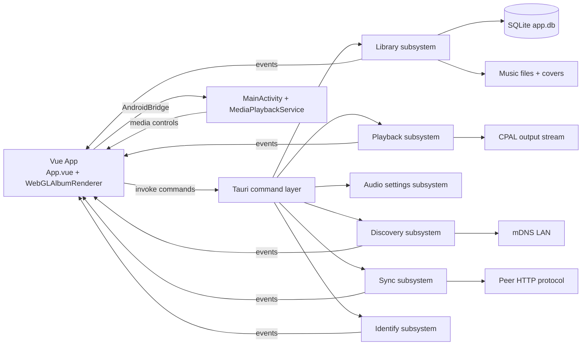
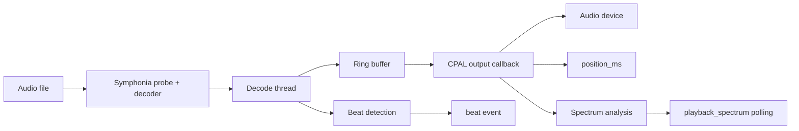

# Project Design

This document describes the current design of the project as it exists in the repository today. It is intentionally descriptive rather than aspirational: it captures the actual architecture, runtime boundaries, state ownership, and known tradeoffs.

## 1. Purpose

Player is a local-first music player built with Vue 3 on the frontend and Rust on the backend through Tauri 2. The application is designed to:

- Index and manage a local music library.
- Play audio files with native output and low-latency controls.
- Store and edit metadata, covers, likes, history, and playlists.
- Support smart playlists defined by filter rules.
- Discover peer devices on the same LAN and sync music and metadata.
- Run on desktop and Android with a native Android media notification.
- Provide a richer now-playing experience, including beat-reactive visuals and a WebGL album renderer.

The project is not designed as a cloud service, a streaming client, or a multi-user system.

## 2. Technology Stack

- Frontend: Vue 3 + TypeScript + Vite.
- Shell/runtime: Tauri 2.
- Backend: Rust.
- Audio decode: Symphonia with a bundled libopus decoder for Opus.
- Audio output: CPAL.
- Local database: SQLite via rusqlite.
- File watching: notify.
- Metadata extraction: lofty.
- LAN discovery: mdns-sd.
- Peer sync transport: tiny_http server + reqwest blocking client.
- Audio identification: rusty-chromaprint + AcoustID.
- Rich now-playing visual: Three.js in a dedicated Vue component.

## 3. Repository Structure

The project is split into a small number of high-value surfaces:

- [src/App.vue](src/App.vue): the main application shell and almost all frontend behavior.
- [src/components/WebGLAlbumRenderer.vue](src/components/WebGLAlbumRenderer.vue): isolated WebGL renderer for the now-playing card.
- [src-tauri/src/lib.rs](src-tauri/src/lib.rs): Tauri bootstrap, managed state registration, and command exposure.
- [src-tauri/src/library.rs](src-tauri/src/library.rs): local library, indexing, persistence, playlists, history, and covers.
- [src-tauri/src/playback.rs](src-tauri/src/playback.rs): audio playback engine, seek, beat detection, spectrum generation.
- [src-tauri/src/audio.rs](src-tauri/src/audio.rs): output device enumeration and auxiliary audio settings state.
- [src-tauri/src/discovery.rs](src-tauri/src/discovery.rs): mDNS peer discovery.
- [src-tauri/src/sync.rs](src-tauri/src/sync.rs): peer HTTP server, file transfer, and metadata merge.
- [src-tauri/src/identify.rs](src-tauri/src/identify.rs): audio fingerprinting and AcoustID lookup.
- [src-tauri/gen/android/app/src/main/java/dev/verncat/player/MainActivity.kt](src-tauri/gen/android/app/src/main/java/dev/verncat/player/MainActivity.kt): Android WebView bridge and OS integration.
- [src-tauri/gen/android/app/src/main/java/dev/verncat/player/MediaPlaybackService.kt](src-tauri/gen/android/app/src/main/java/dev/verncat/player/MediaPlaybackService.kt): Android media notification and media session service.

## 4. High-Level Architecture



The system is intentionally split across three runtime layers:

- The Vue frontend owns screen state, queue logic, and interaction flow.
- The Rust backend owns local persistence, audio IO, indexing, sync, discovery, and native events.
- The Android layer owns OS-facing playback controls and notification/session behavior.

An important design choice is that queue semantics live in the frontend, not the backend. Rust playback is track-centric; Vue decides what "next", "previous", "repeat", and "up next" mean.

## 5. Frontend Design

### 5.1 Main UI shell

The frontend is centered around [src/App.vue](src/App.vue). This file acts as:

- The top-level application shell.
- The navigation controller.
- The playback coordinator.
- The queue owner.
- The modal/menu controller.
- The event listener hub for Tauri events.
- The responsive/mobile layout host.

This is a deliberately pragmatic but monolithic design: most state is colocated with the UI that consumes it, at the cost of a very large single-file component.

### 5.2 Navigation model

`activeNav` in [src/App.vue](src/App.vue) selects the major screen. Current views are:

- `home`: recent tracks and a curated/demo "Made For You" section.
- `library`: full library grouped by artist.
- `search`: currently a placeholder view.
- `history`: play history.
- `playlists`: regular playlists and smart playlists.
- `discovery`: peer devices and sync controls.
- `friends`: local Player contacts added by Profile ID.
- `friend`: a friend page addressed by Profile ID, with Soulseek private messaging.
- `settings`: preferences, with addressable Library, Playback, Devices & Sync, Soulseek, Appearance, and About sections.

On mobile, navigation is presented as a side drawer opened by a burger button instead of a permanently visible desktop sidebar.

### 5.3 UI sections and behavior

The main UI currently supports:

- Recent tracks on the home screen.
- Library browsing grouped by artist.
- Inline playback badges for current track and next track.
- Regular playlists backed by SQLite.
- Smart playlists defined by rules and evaluated against the loaded library snapshot.
- Play history view.
- Discovery and sync dashboard.
- Device settings modal for sync identity.
- Track edit modal, identify workflow, playlist menus, and long-press mobile context menus.
- A persistent footer player and a larger detail/now-playing card.

The "Made For You" section is currently static demo content defined in [src/App.vue](src/App.vue), not a backend-driven recommendation system.

### 5.4 State ownership

Frontend state is stored in Vue refs and computed values rather than a dedicated store library. The main state groups are:

- Playback presentation state: `isPlaying`, `currentTime`, `duration`, `volume`.
- Queue state: `queueSource`, `queueSourceIndex`, `queue`, `nowPlaying`, `queuePlaylistTracks`.
- Library state: `libraryTracks`, `recentTracks`, `historyEntries`.
- Playlist state: `playlists`, `playlistView`, smart playlist editing/view state.
- Discovery/sync state: `peers`, `syncEnabled`, `syncProgress`, device identity state.
- Visual state: detail card transforms, beat animation, spectrum levels.
- Modal/menu state: settings, device menu, queue menu, add-to-playlist menu, track context menu.

The design favors directness over abstraction. Most actions are plain functions inside [src/App.vue](src/App.vue) that call Tauri commands and then update refs.

### 5.5 Queue and transport control design

Queue behavior is frontend-owned:

- `playTrackFrom(...)` chooses a source list and starts playback of a single file.
- `playNext()` and `playPrev()` are implemented in Vue using local queue state.
- `refillQueue()` computes up to five upcoming items.
- Repeat and shuffle modes are UI-level concerns.
- Track list badges such as "now playing" and "up next" are derived from Vue state.

This means the backend does not maintain playlist playback state. The backend only knows about the currently loaded file and its playback position.

### 5.6 Event integration

The frontend listens to native/backend events emitted by Rust:

- `beat`: drives beat-reactive animation.
- `discovery-peers`: updates visible LAN peers.
- `sync-progress`: updates per-peer sync progress.
- `index-progress`: shows local indexing progress.
- `identify-progress`: shows track identification progress.
- `library-changed`: reload trigger after indexing, identification, or sync.
- `playback-finished`: fallback path for end-of-track handling.

On Android there is also a direct JS bridge surface:

- `window._playbackFinished()`: invoked directly from Rust/Android to avoid background event timing issues.
- `window._mediaControl(action)`: invoked by Android media notification buttons.

### 5.7 Visual design

Interface icons use the official `@lucide/vue` package through [src/components/AppIcon.vue](src/components/AppIcon.vue), with an explicit icon registry in [src/icons.ts](src/icons.ts). Icons share a 24px viewBox and a stroke width of 2. Liked hearts use a filled state. Native select arrows use bundled SVG exports of Lucide ChevronDown. The Lucide license is included in [public/licenses/lucide.txt](public/licenses/lucide.txt). Application artwork and device emoji remain separate assets.

The current visual system combines music metadata with generated decoration:

- Cover art is shown when available.
- When no cover is available, the UI derives gradients from the track hash.
- Tracks have rarity metadata that controls tinting and some animation.
- The now-playing detail view combines a WebGL-rendered album object with a CSS-driven spectrum ring.
- Beat events animate player controls and art using a decaying pulse model.
- Mobile typography, footer sizing, drawer navigation, and long-press menus were added to keep the same UI viable on phones.

### 5.8 WebGL now-playing component

[src/components/WebGLAlbumRenderer.vue](src/components/WebGLAlbumRenderer.vue) isolates the 3D portion of the now-playing detail card. It receives:

- `coverUrl`
- two palette colors
- rarity color
- beat scale
- play/pause state
- pointer tilt and offset
- dragging state

Responsibilities of this component:

- Build and own the Three.js renderer, scene, camera, geometry, and materials.
- Load real cover textures or generate gradient textures as fallback.
- Render a rounded album/card object with sheen/highlight effects.
- React to playback state, beat scale, and pointer motion without exposing Three.js details to the rest of the app.

This keeps the rendering code separate while the rest of the visual chrome remains in [src/App.vue](src/App.vue).

### 5.9 Settings

[src/components/SettingsView.vue](src/components/SettingsView.vue) groups preferences into sections, with optional integrations shown when available. On desktop it uses a section menu beside the active panel. On mobile it opens with a section list and shows each section on its own screen. Section changes participate in the existing navigation history, and the footer player remains available.

[src/components/AppTopbar.vue](src/components/AppTopbar.vue) accepts an optional page title and subtitle beside the navigation arrows. Main page headings use this area, including the current playlist name. The flexible playlist editor keeps its editable name in the header. Section headings remain inside the content, and filters and page actions remain next to their controls.

- Library shows the data folder, indexing progress, a Show duplicates switch, and access to duplicate review and identification. The switch controls the existing shared duplicate filter.
- About includes a Licenses link opening `public/licenses/third-party.txt` in the GitHub repository default branch. The file must be published with the app source for the link to resolve. `pnpm build` runs `scripts/generate-licenses.mjs` to collect installed npm runtime dependencies and Cargo dependencies for the build target into `public/licenses/third-party.txt`. Bundled license and notice files are preserved; packages declaring only an SPDX identifier use standard texts from `spdx-license-list`. Packages with no license metadata are explicitly identified. `LICENSES_TARGET` can override the target, otherwise the Tauri target, Cargo target, or Rust host is used. Run `pnpm licenses:generate` to refresh the file for development.
- Playback shares audio output and sample rate state with the footer device picker.
- Discord RPC has its own settings section for the optional desktop integration. It is disabled by default and stored per device. See [Discord Rich Presence](#510-discord-rich-presence) for setup, architecture, and checks.
- Devices & Sync edits this device identity and controls the existing LAN sync setting. Peer management stays in the Devices view.
- Soulseek owns credential drafts with explicit Save and Cancel actions. Device and Soulseek forms read the latest saved configuration before writing, so saving one form preserves the other settings.
- Appearance stores device-local preferences in localStorage through [src/composables/useAppearance.ts](src/composables/useAppearance.ts). Reduced motion also respects the system preference, stops beat and cover motion, and uses a still cover. The 3D cover and rarity animations can be controlled independently.
- About uses [src/components/AboutPanel.vue](src/components/AboutPanel.vue) for version information, the existing updater flow, release notes, and contributor profiles. Each frontend build runs [scripts/sync-contributors.mjs](scripts/sync-contributors.mjs) to refresh GitHub contributors and download their avatars into bundled assets. A checked-in snapshot keeps development and offline builds usable. The application makes no network requests to display these credits.

Device identity and Soulseek credentials keep their existing SQLite persistence. Appearance preferences are separate from music metadata and are not synced. Long-running actions report progress, and setting failures remain visible next to the affected controls.

### Friends

[src/components/FriendsView.vue](src/components/FriendsView.vue) is a separate page below Devices in the sidebar, with its title in the shared topbar. It lists saved Player contacts, filters them by name or Profile ID, and uses the existing responsive popup to add a contact by UUID with an optional local name. Profile IDs are independent of external services. Adding a contact starts an optional Soulseek interest lookup; no match or an automatic lookup failure does not mark the contact as invalid or show a warning. The row can retry this lookup manually, with errors shown for that explicit action. Matching Soulseek usernames are shown as unverified candidates. There is no friend request, online status, or Discord dependency.

[src-tauri/src/friends.rs](src-tauri/src/friends.rs) provides `get_friends`, `add_friend`, and `remove_friend`. Contacts live in the local library database, scoped to the current profile ID. Inputs are validated natively, self-additions and duplicates are rejected, and changing profiles selects a separate list. Soulseek candidates and the last successful lookup time are also stored. A timeout is an error, not an empty result. Contacts are not currently synchronized to other devices, even when they share the profile key. Saved IDs are contacts, not trusted devices or proof of identity.

[src/components/FriendChatView.vue](src/components/FriendChatView.vue) opens when selecting a friend. The shared topbar shows their local name, Friends stays selected in the sidebar, and back/forward history retains the Profile ID. The message pane uses the player palette with green outgoing bubbles, a fixed composer above the footer player, a styled scrollbar, and paginated history. Enter sends, Shift+Enter adds a line, and IME composition does not submit. Multiple discovered Soulseek usernames require choosing a conversation; the custom responsive account menu does not use a native select. Friends without a Soulseek account keep their independent profile page and an optional account search.

[src-tauri/src/private_messages.rs](src-tauri/src/private_messages.rs) stores incoming and outgoing PMs in SQLite scoped by Player profile, local Soulseek account and remote username. Historical friend-account mappings remain available if discovery later omits that account. Native commands validate the friend and target username, and recheck the active profile/account after connection before sending. The view polls the local database every two seconds while open, loads 100 messages per page and preserves scroll position when reading older messages. Message bodies render as plain text.

The shared Soulseek connection supports server messages 22 (PM) and 23 (receipt acknowledgement). Incoming messages are acknowledged only after storage succeeds; replayed IDs/timestamps are deduplicated. Message bodies are not logged by the PM handler. A completed socket write means submitted to Soulseek, not delivered or read by the recipient. Failed or interrupted sends retain their local record and are never retried automatically. Conversation history is local to this installation and is not synchronized or end-to-end encrypted by Player. Enabling Soulseek keeps its connection available for receiving PMs even when Profile ID publication is off.

### 5.10 Discord Rich Presence

Discord Rich Presence is an optional desktop integration. It is off by default and can be enabled in Settings, Discord RPC. The preference is stored on this device. Pausing, stopping, or disabling the integration clears the activity.

#### Application setup

Player uses the public Application ID `1562037965537157120` by default. Regular development and release builds need no environment variable. No bot token, Client Secret, or user authentication is required.

Upload the Player application icon as a Rich Presence art asset named `player` in the [Discord Developer Portal](https://discord.com/developers/applications).

Forks can create their own Discord application and override the public Application ID when compiling:

```sh
DISCORD_CLIENT_ID=your_application_id pnpm tauri dev
DISCORD_CLIENT_ID=your_application_id pnpm tauri build
```

For release builds, the optional repository Actions variable `DISCORD_CLIENT_ID` overrides the default. An unset or empty variable keeps Player's Application ID. An invalid override disables the switch with a configuration message. Android and builds without the feature do not show the integration.

The Discord desktop client must be running with activity sharing enabled. The integration retries when Discord is closed or restarts. It publishes the track title and artist, playback timestamps, and normally the album as image hover text. It does not upload local cover art or send file paths. The configured art asset supplies the application icon.

The optional Discord discovery switch in the Discord RPC section publishes profile discovery metadata. It is off by default and stored per device as `player.discord-discovery`. While RPC and discovery are both enabled and music is playing, `assets.small_url` contains exactly `adhd://v1/<public-key>`, using the Base64 public key displayed in Devices & Sync. The native command reads this key directly from the current local profile and ignores discovery keys supplied in playback snapshots. The frontend refreshes presence when the profile changes. The album tooltip in `assets.large_text` is preserved. Turning discovery off removes `assets.small_url` immediately, bypassing the normal update throttle. Pausing or disabling RPC still clears the whole activity. This marker supplies public identity metadata for Discord discovery consumers.

#### Boundaries

- `src/composables/useDiscordPresence.ts` adapts the existing playback state to a small metadata snapshot. It persists the preference and forwards meaningful playback changes, including seeks, rather than every playback tick.
- `src-tauri/src/discord_presence.rs` owns the IPC connection, background worker, update coalescing, reconnects, and cleanup. It does not own playback or library state.
- The `discord-rpc` Cargo feature controls the dependency and implementation. It is included by default for desktop builds and can be omitted with `pnpm tauri build -- --no-default-features`.

These boundaries allow a future plugin API to replace the adapter without changes to the audio engine. There is no general plugin framework in this implementation.

#### Checks

```sh
cargo test --manifest-path src-tauri/Cargo.toml discord_presence --lib
cargo check --manifest-path src-tauri/Cargo.toml --no-default-features --lib
```

The unit tests cover disabled behavior, immediate pause and disable cleanup, update coalescing, reconnection, timestamps after seeking, and Unicode metadata. Testing the appearance in a real Discord profile requires the configured application and a running Discord desktop client.

## 6. Backend Design

### 6.1 Tauri bootstrap

[src-tauri/src/lib.rs](src-tauri/src/lib.rs) does four things:

- Creates the Tauri application.
- Registers managed state objects.
- Auto-starts peer discovery during setup.
- Exposes the Rust command surface to the Vue frontend.

Managed state currently includes:

- `LibraryState`
- `AudioState`
- `PlaybackState`
- `DiscoveryState`
- `SyncState`

### 6.2 Command surface

The command layer is wide but straightforward.

Library commands:

- `search_tracks`
- `get_all_tracks`
- `reindex`
- `update_track`
- `toggle_like`
- `get_data_dir`
- `record_play`
- `get_recent_tracks`
- `get_play_history`
- `get_playlists`
- `create_playlist`
- `rename_playlist`
- `delete_playlist`
- `get_playlist_tracks`
- `add_track_to_playlist`
- `remove_track_from_playlist`
- `get_smart_playlists`
- `save_smart_playlist`
- `delete_smart_playlist`
- `get_device_emoji`
- `set_device_emoji`
- `get_device_settings`
- `set_device_settings`

Audio commands:

- `get_output_devices`
- `set_output_device`
- `get_volume`
- `set_volume`

Playback commands:

- `playback_play`
- `playback_pause`
- `playback_resume`
- `playback_stop`
- `playback_seek`
- `playback_set_volume`
- `playback_spectrum`
- `playback_status`

Discovery commands:

- `discovery_start`
- `discovery_stop`
- `discovery_peers`

Sync commands:

- `sync_set_enabled`
- `sync_get_enabled`
- `sync_with_peer`

Identify commands:

- `identify_tracks`

## 7. Library and Persistence Design

### 7.1 Data directory

The app is local-first and assumes a single writable library root.

- On Android, the data directory is `/sdcard/Player`.
- On non-Android targets, the data directory is `<app_data_dir>/data`.

Expected music layout is flexible, but the code assumes audio files live under this root and stores relative paths in the database.

### 7.2 Database

Persistence is centered around a single SQLite file: `app.db` under the data directory.

Main tables:

- `tracks`: core metadata, path, duration, cover hash, file hash, rarity, manual edits, likes, play count, year, genre, date added.
- `play_history`: playback history tied to track IDs.
- `device_config`: local device UUID, emoji, user-visible device name, sync preferences, and Soulseek settings.
- `playlists`: regular playlists.
- `playlist_tracks`: ordered membership of tracks in playlists.
- `smart_playlists`: saved smart playlist definitions.

Design notes:

- Schema migration is handled inline with additive `ALTER TABLE` statements, not with a separate migration framework.
- Covers are extracted during indexing and kept once per distinct image as small resized files (`covers.rs`); tracks reference them by `cover_hash`.
- Local track identity is the SQLite row ID.
- Cross-device identity is the file hash.

### 7.3 Metadata acquisition

Metadata is built with a priority chain:

1. Embedded audio tags.
2. Folder structure heuristics.
3. Filename parsing.

This keeps the library usable even when tags are missing or inconsistent.

### 7.4 Indexing model

The library subsystem in [src-tauri/src/library.rs](src-tauri/src/library.rs) is responsible for:

- Creating the data directory.
- Opening and initializing the database.
- Performing a full scan on first launch.
- Starting a filesystem watcher for incremental updates.
- Extracting metadata and covers from audio files.
- Hashing files for deduplication and sync.
- Emitting progress and library change events.

Important design decision:

- A full scan only happens automatically on first database creation.
- Later launches rely on the filesystem watcher plus user-triggered manual reindex.

This keeps startup cost lower after the initial import.

### 7.5 Playlists

There are two playlist systems:

- Regular playlists: stored in SQLite as explicit ordered track memberships.
- Smart playlists: stored in SQLite as saved rule sets, but evaluated in the frontend against the loaded library snapshot.

Smart playlist rules can currently target fields such as title, artist, album, genre, extension, year, play count, like state, and date added.

This is a hybrid design:

- Persistence lives in Rust/SQLite.
- Evaluation currently lives in Vue.

That makes iteration on UI rules easy, but it means smart playlist results are computed on the client side and depend on the currently loaded full library state.

## 8. Playback Design

### 8.1 Core model

[src-tauri/src/playback.rs](src-tauri/src/playback.rs) implements playback as a shared-state engine with:

- A decode thread.
- A ring buffer between decode and output.
- A CPAL output callback.
- Atomic playback state for play/pause/stop/position/duration/volume.
- Real-time beat and spectrum analysis.
- End-of-track notification back into the frontend.

### 8.2 Playback pipeline

[src-tauri/src/audio_codecs.rs](src-tauri/src/audio_codecs.rs) provides a shared codec registry with all enabled Symphonia codecs and an Opus adapter backed by the `opus` crate. Libopus is compiled and linked statically. The adapter validates OpusHead, applies its output gain, handles packets up to 120 ms, and maps mono through 7.1 channel layouts into Symphonia channel order. Ogg Opus uses gapless packet trimming and 80 ms of seek pre-roll, discarding decoded samples before the requested position.

The local `symphonia-format-ogg` Cargo patch fixes Opus pre-skip and end padding, including streams containing only one audio page and packets queued before start/end probing. Its provenance and changes are recorded in [src-tauri/vendor/symphonia-format-ogg/PATCHES.md](src-tauri/vendor/symphonia-format-ogg/PATCHES.md). Other Ogg codecs retain the upstream demuxer behavior. Synthetic fixtures cover Opus decoding and seeking, channel order, long packets, and FLAC/MP3/Vorbis regression checks without an audio device.



### 8.3 State invariants

Important current invariants:

- Only one active playback stream is intended at a time.
- `play()` stops previous playback before starting new decode.
- `seek()` is implemented by stopping and restarting decode from the target position.
- `position_ms` represents audible progress, not decoder-head progress.
- Spectrum data is derived from frames actually consumed by the output callback.

That last invariant matters because buffered decode can run ahead of audible playback. The current implementation updates position from audio frames actually sent to the output stream, which keeps seeks and progress consistent.

### 8.4 Beat and spectrum design

The playback engine generates two visualization signals:

- Beat events: emitted from an energy-window detector in the decode pipeline.
- Spectrum: a 32-band FFT-based snapshot updated from output-consumed audio.

The frontend consumes them differently:

- Beat is event-driven.
- Spectrum is polled via `playback_spectrum` while the detail view is open.

This split reduces event chatter while still providing responsive motion.

### 8.5 Output device and volume design

There are two related but not fully unified backend surfaces:

- `AudioState` in [src-tauri/src/audio.rs](src-tauri/src/audio.rs) exposes device enumeration and a generic volume state.
- `PlaybackState` in [src-tauri/src/playback.rs](src-tauri/src/playback.rs) owns the actual playback stream volume and selected output device used by the stream.

Today, the UI uses `playback_set_volume` for real playback volume, but device selection flows through `AudioState`. This is a known architectural split and should eventually be unified so the device picker controls the same state the playback stream actually uses.

### 8.6 End-of-track behavior

When playback finishes naturally:

- Rust marks playback as finished.
- On Android, Rust tries to call `window._playbackFinished()` directly through the WebView.
- A Tauri `playback-finished` event is also emitted as fallback.
- The Vue app advances the queue and resynchronizes Android media state.

This direct callback exists because relying only on WebView-side Tauri event listeners was not reliable enough when Android background behavior was involved.

## 9. Discovery and Sync Design

### 9.1 Discovery

[src-tauri/src/discovery.rs](src-tauri/src/discovery.rs) implements peer discovery over mDNS/DNS-SD.

Each instance:

- Advertises itself as `_player._tcp.local.`.
- Browses for the same service type.
- Tracks peer host, addresses, port, device name, and emoji.
- Emits `discovery-peers` whenever the peer list changes.

Discovery is started automatically during app setup.

### 9.2 Sync protocol

[src-tauri/src/sync.rs](src-tauri/src/sync.rs) provides both server and client behavior.

When sync is enabled, the local app serves a small HTTP API on port `57322`:

- `GET /tracks`: index of available tracks with hashes and metadata.
- `GET /file/<hash>`: raw file content for a specific track hash.
- `GET /sync-data`: track metadata, playlists, smart playlists, and history.

Sync is hash-based:

- Files are identified by `file_hash`.
- Missing files are downloaded from peers.
- Hash collisions are treated as duplicates rather than separate items.
- Metadata and playlists are merged after transfer.

Frontend interaction model:

- The discovery view shows peers.
- Sync can be globally enabled or triggered per peer.
- Progress is streamed back through `sync-progress` events.

### 9.3 Device identity

Each device has two user-facing identity fields:

- `device_name`
- `emoji`

These are stored in `device_config`, exposed through sync endpoints, and shown in the discovery UI. This gives a friendly identity layer without a formal account system.

Each installation also has a random UUID v4 stored as `device_config.device_id`. Schema initialization creates it for new databases and backfills existing installations without changing their preferences. Renaming the device, changing its emoji, saving other settings, and restarting the app preserve the UUID. `get_device_settings`, `/status`, and `/tracks` expose it, and discovery carries it as optional peer metadata so older peers remain compatible. It is independent of hostname and IP address. The current discovery map still uses mDNS service names as keys.

The device UUID identifies an app database, not physical hardware or a user account. Copying `app.db` also copies the device UUID; removing the database creates a new device identity on the next launch. Demo mode uses its temporary in-memory database. The device UUID does not grant access or authenticate peers.

### Player profile discovery through Soulseek

When Soulseek is enabled and configured and **Publish Profile ID** is on, a background task reuses the normal Soulseek client and publishes `adhdplayer-v1-<canonical Profile UUID>` as an interest with server message 51 (`AddThingILike`). Publication is off by default and persisted per device in `device_config.soulseek_discovery_enabled`. Finding friends does not require publishing your own ID. The toggle wakes the discovery task immediately; disabling publication removes the recorded marker when connected, with retry on reconnection if necessary. It also checks settings and profile changes every 15 seconds. The server actor republishes the current marker after reconnecting. The previous marker for each Soulseek username is stored in SQLite and removed with message 52 on profile replacement; cleanup on disabling or changing credentials is best effort while the old connection is usable. Other interests are untouched. Publication has no server acknowledgement and stale entries can remain after an interrupted session.

`resolve_friend` requests message 112 (`ItemSimilarUsers`) for the same marker, correlates replies by item, applies the shared search rate limiter and a bounded timeout, and saves every returned username as an unverified candidate for that contact. Parsing bounds strings and result counts. Multiple Soulseek accounts may advertise one Player profile. The public marker may be copied; it does not prove ownership of the profile key and never grants sync, pairing or device trust. Interest indexing, server result caps and real-world discovery reliability require live testing; no completeness guarantee is assumed.

### 9.4 Local profiles and device pairing

[src-tauri/src/profile.rs](src-tauri/src/profile.rs) owns a local X25519 profile key pair. `user_id` is a deterministic UUID v5 derived from the public key using the OID namespace. Linked devices share the same private key, public key, and user UUID while keeping independent device UUIDs. Every linked device can share the profile; there is no primary device or permission hierarchy.

The private key is stored as 32 raw bytes in `identity/profile.key` under Tauri's app-local data directory. On Android this is private app storage, separate from the shared music directory. On Unix the directory is mode 0700 and the key file is mode 0600; Windows uses the app-local directory's inherited access controls. Atomic file replacement persists a received profile before replacing the in-memory key. A corrupt key file produces an error instead of silently creating a different profile. Demo mode keeps an ephemeral profile in memory. The key is not encrypted at rest. Sync data, status responses, logs, and contributor/build artifacts omit it. Settings can explicitly request the key through a separate local command as described below.

[src/components/DevicePairing.vue](src/components/DevicePairing.vue) uses the existing responsive popup and lives outside the Devices route so a session remains visible when navigating. The flow is:

1. On a device already using the desired profile, open Devices and choose **Allow linking**. This opens a three-minute window for one incoming session.
2. On the joining device, choose **Use profile** next to that device and confirm the direction. The popup explains that its current profile will be replaced while its library stays local.
3. Both screens show three groups of four hexadecimal digits. Compare all groups, then confirm on both devices. The source screen explicitly says that sharing the profile also lets the new device link more devices.
4. The source transfers its private key through the encrypted session only after both confirmations. The receiver verifies that it derives the public key authenticated by the handshake, saves it, and refreshes the displayed profile. Changing profiles affects only this installation; other devices using the previous profile keep that profile.

Pairing uses [snow](https://docs.rs/snow/0.10.0/snow/) with `Noise_XX_25519_ChaChaPoly_BLAKE2s`, fresh handshake keys, a session ID bound through the prologue, and a 48-bit code from the completed handshake transcript. Device labels are also bound into that transcript. The joining device checks the source's static public key and device UUID against its selected discovery entry. `/profile-pairing/start`, `/profile-pairing/finish`, and `/profile-pairing/exchange` carry handshake messages or encrypted transport messages. They require JSON POST requests with bounded bodies. Session windows, a single active session, limited initial attempts, nonce-based replay rejection, explicit cancellation, HTTP timeouts, and disabled redirects bound the exchange. Losing or tampering with a transport message fails the session instead of silently restarting its nonce sequence.

Settings, Devices & Sync shows read-only Profile ID and Public key fields, and a Private key field hidden by default. Show requests the Base64-encoded private key through `local_profile_private_key`; Hide, changing settings sections, and unmounting the view clear the displayed key. Stale async responses cannot reveal it after leaving the section. `local_profile_info` continues to expose only the public key and user UUID. Devices omits the old summary row with the profile ID, device count, sync state, and discovery method.

Pairing commands separately allow, join, inspect, confirm, and cancel sessions; network and file work runs on blocking workers. `/status`, `/tracks`, and discovery expose optional `user_id` and `profile_public_key` fields for compatibility with old peers. The Shared profile label compares announced keys; it is not an authorization decision. Existing music sync and remote playback endpoints retain their current access behavior. Pairing does not automatically start a music sync.

Sharing the private key means a lost device cannot be individually revoked from the profile. Changing the shared key changes the user UUID and requires linking the remaining devices to the new profile. Cancelling a pending session does not revoke a key that was already transferred. Profile import, backup files, and key rotation do not yet have UI flows.

Tests cover persistence and private file permissions, key validation, comparison codes, two-sided confirmation, encrypted transfer, replay and tamper rejection, cancellation, expiry, old peer payloads, and an HTTP round trip between two loopback peers:

```sh
cargo test --locked --manifest-path src-tauri/Cargo.toml --lib
pnpm exec vue-tsc --noEmit
```

## 10. Track Identification Design

[src-tauri/src/identify.rs](src-tauri/src/identify.rs) provides metadata enrichment for existing local files.

Pipeline:

- Decode audio to PCM.
- Generate Chromaprint fingerprint.
- Query AcoustID.
- Write matched metadata back into the local library.
- Emit `identify-progress` to drive the frontend progress UI.

This subsystem is intentionally asynchronous and event-driven because identification can be slow and network-bound.

## 11. Android Design

### 11.1 Why Android needs a native layer

Tauri provides the embedded app shell, but Android playback UX still needs direct native integration for:

- Media notification controls.
- MediaSession playback state.
- Foreground service lifecycle.
- File-system permission handling.
- WebView-to-native bridging.

### 11.2 MainActivity bridge

[src-tauri/gen/android/app/src/main/java/dev/verncat/player/MainActivity.kt](src-tauri/gen/android/app/src/main/java/dev/verncat/player/MainActivity.kt) adds Android-specific behavior around the Tauri activity.

Key responsibilities:

- Store a weak reference to the WebView.
- Expose `AndroidBridge` JS methods to the frontend.
- Forward media session button actions back into JS.
- Request all-files access on Android when needed.
- Ensure `/sdcard/Player` exists.
- Acquire a Wi-Fi multicast lock so mDNS discovery works on Android.

Bridge methods exposed to JS:

- `updatePlayback(title, artist, isPlaying, positionSec, durationSec)`
- `stopPlayback()`
- `openFolder(relativePath)`

### 11.3 MediaPlaybackService

[src-tauri/gen/android/app/src/main/java/dev/verncat/player/MediaPlaybackService.kt](src-tauri/gen/android/app/src/main/java/dev/verncat/player/MediaPlaybackService.kt) owns Android's playback notification and media session.

Responsibilities:

- Maintain current title, artist, play/pause state, position, and duration.
- Publish a foreground media notification.
- Maintain a MediaSession with play/pause/next/previous/seek actions.
- Forward notification actions back into the WebView through `MainActivity.sendToJs(...)`.

### 11.4 Frontend/native contract

The Android notification is not driven directly by Rust playback state. Instead:

- Vue owns queue semantics and user-visible track identity.
- Vue calls `syncAndroid()` whenever the visible playback state changes.
- Native Android surfaces then mirror the frontend's notion of the current track.

This is an intentional consequence of frontend-owned queue behavior: the native layer mirrors the UI state rather than independently deriving playlist flow.

## 12. Events and Data Flow

### 12.1 Frontend to backend

Most frontend actions use direct Tauri `invoke(...)` calls. Typical flow:

1. User clicks a track.
2. Vue decides the source list and queue implications.
3. Vue invokes `playback_play` with a file path.
4. Vue starts polling `playback_status` and `playback_spectrum` as needed.
5. Vue pushes current state into Android via `syncAndroid()` when applicable.

### 12.2 Backend to frontend

Background or long-running subsystems communicate through events:

- Indexing and identify report progress.
- Discovery publishes peer snapshots.
- Sync publishes per-peer phase changes.
- Playback publishes beat pulses and completion notifications.
- Library writes emit `library-changed` so the frontend can reload derived state.

This gives the app a mixed model:

- Commands for request/response operations.
- Events for asynchronous, background, or streaming updates.

## 13. Build and Runtime Targets

Relevant package scripts in [package.json](package.json):

- `pnpm dev`: Vite-only frontend dev server.
- `pnpm build`: frontend typecheck and bundle.
- `pnpm tauri dev`: Tauri desktop/mobile dev.
- `pnpm android:build`: Android build.
- `pnpm android:sign`: signs the release APK.
- `pnpm android:deploy`: installs a previously built signed APK.
- `pnpm android:build-deploy`: full Android build followed by deploy.

The repository currently includes generated Android project files under `src-tauri/gen/android`. Those files are part of the build output surface for Android, but some of them also contain project-specific customizations and should be treated as part of the effective runtime design.

## 14. Known Tradeoffs and Constraints

The current design is functional and pragmatic, but several tradeoffs are explicit:

- [src/App.vue](src/App.vue) is a very large, stateful single-file component.
- Queue logic is in Vue, while playback execution is in Rust; this keeps UI control flexible but requires explicit synchronization.
- Smart playlist definitions are stored in SQLite, but rule evaluation is still frontend-side.
- The search view exists in the UI shell but is not implemented yet.
- The home screen includes hardcoded demo cards for "Made For You".
- Android media state depends on explicit frontend-to-native synchronization rather than a native-only playback source of truth.
- Output device state is currently split between `AudioState` and `PlaybackState`.
- Schema migration is additive and inline, not centrally versioned.
- Sync is optimized for trusted local networks and does not implement authentication, encryption, or conflict-heavy collaborative semantics.

These are not hidden bugs in the document; they are part of the current design reality.

## 15. Recommended Refactoring Directions

If the project grows, the highest-value refactors are:

- Split [src/App.vue](src/App.vue) into feature components and composables.
- Move smart playlist evaluation into Rust so results are queryable and consistent across screens and devices.
- Unify output device and volume ownership so the UI talks to a single playback settings surface.
- Introduce a clearer playback state machine shared by Rust, Vue, and Android sync code.
- Tighten the sync protocol with version negotiation, optional auth, and better conflict policy.
- Refresh [README.md](README.md) so repository-level documentation matches the real product instead of the default template.

## 16. Summary

The project is a local-first music player with a deliberately mixed architecture:

- Vue owns screen flow, queue behavior, and rich interaction.
- Rust owns persistence, IO, native audio, and background work.
- Android code owns OS playback integration.

The design favors shipping useful behavior quickly over deep abstraction. That shows up most clearly in the monolithic Vue shell, the frontend-owned queue, the event-heavy background flows, and the direct Android bridge. Despite those tradeoffs, the overall architecture is coherent: the app is built around a single local library, a single active playback engine, and optional LAN-based peer sync.
