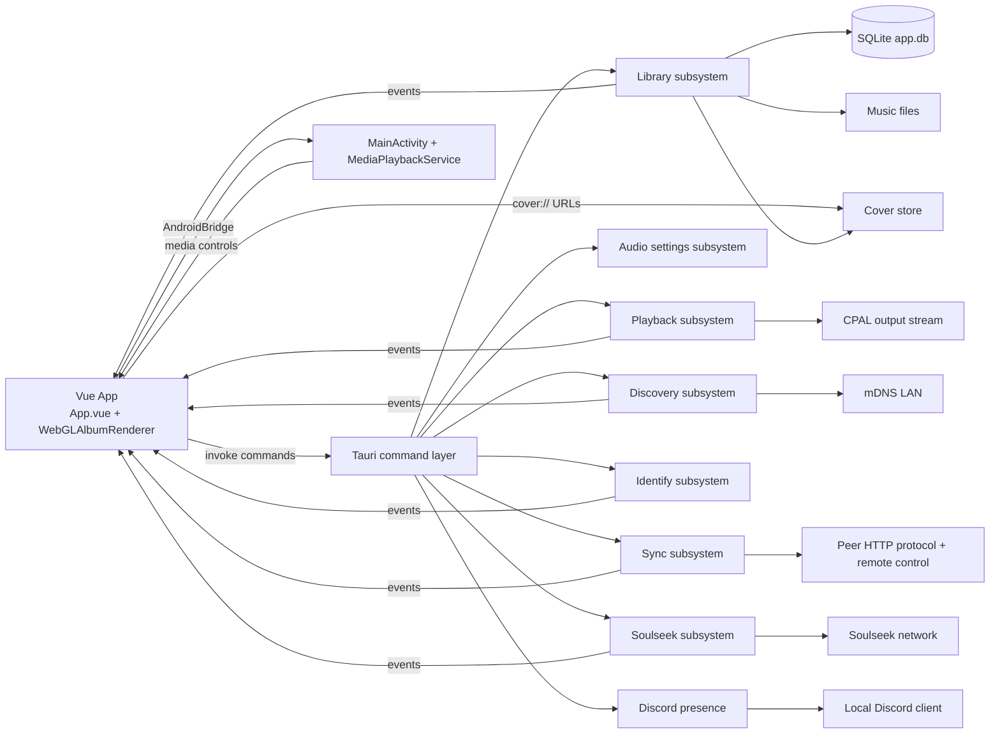
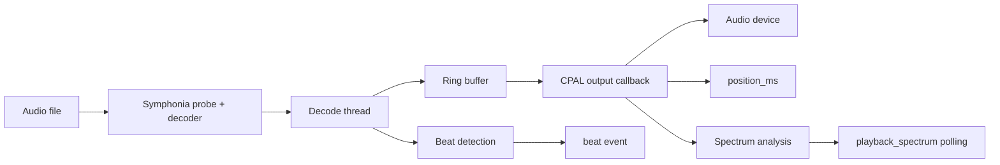

# Project Design

This document describes the current design of the project as it exists in the repository today. It is intentionally descriptive rather than aspirational: it captures the actual architecture, runtime boundaries, state ownership, and known tradeoffs.

## 1. Purpose

Player is a local-first music player built with Vue 3 on the frontend and Rust on the backend through Tauri 2. The application is designed to:

- Index and manage a local music library.
- Play audio files with native output and low-latency controls.
- Store and edit metadata, covers, likes, history, and playlists.
- Support smart playlists defined by filter rules.
- Discover peer devices on the same LAN and sync music and metadata.
- Hand playback over to another device on the LAN, and control it from there.
- Search, preview and download music from the Soulseek network.
- Find and flag duplicate tracks, and replace a track's file with a better copy.
- Run on desktop and Android with a native Android media notification.
- Provide a richer now-playing experience, including beat-reactive visuals and a WebGL album renderer.
- Check for and install updates.

The project is not designed as a cloud service, a streaming client, or a multi-user system.

## 2. Technology Stack

- Frontend: Vue 3 + TypeScript + Vite.
- Shell/runtime: Tauri 2.
- Backend: Rust.
- Audio decode: Symphonia with a bundled libopus decoder for Opus.
- Audio output: CPAL.
- Local database: SQLite via rusqlite.
- File watching: notify.
- Metadata extraction: lofty.
- LAN discovery: mdns-sd.
- Peer sync transport: tiny_http server + reqwest blocking client.
- Soulseek client: soulseek-rs, vendored at `src-tauri/vendor/soulseek-rs-lib` (the `soulseek-rs-repo/` submodule is an upstream workbench copy, not a build dependency).
- Cover resizing: image.
- Audio identification: rusty-chromaprint + AcoustID.
- Rich now-playing visual: Three.js in a dedicated Vue component.
- Discord Rich Presence (desktop, optional): discord-rich-presence.
- Icons: Lucide (`@lucide/vue`).
- Logging and profiling: tracing, with optional Tracy output (`tracy` feature).

## 3. Repository Structure

Frontend:

- [src/App.vue](src/App.vue): the application shell: navigation, queue, playback coordination, modals, and most event listeners.
- [src/components/](src/components/): extracted UI. `AppSidebar`, `AppTopbar`, `PlayerBar` (footer player with queue and device menus), `ResponsivePopup`, `TrackRow` and `TrackMeta` (track lists), `ArtistView`, `AlbumView`, `AlbumCard` and `PageHeader` (artist and album pages), `CoverImage`, `ImagePreview` (full-window cover view), `SettingsView`, `SettingsToggle` and `AboutPanel` (the settings page), `AppIcon` (Lucide icons), and `WebGLAlbumRenderer` (the 3D now-playing card).
- [src/composables/useTrackActions.ts](src/composables/useTrackActions.ts): the track actions (like, edit, menus, opening artist and album pages) that App.vue provides to track lists.
- [src/composables/useHistoryNavigation.ts](src/composables/useHistoryNavigation.ts): back/forward navigation kept in the browser history, and transient history entries for UI state that back should undo.
- [src/composables/useAppearance.ts](src/composables/useAppearance.ts) and [src/composables/useDiscordPresence.ts](src/composables/useDiscordPresence.ts): appearance preferences and the Discord Rich Presence adapter.
- [src/api.ts](src/api.ts): the start of a frontend API layer (artist and album queries).
- [src/utils/](src/utils/): formatting, rarity colors, special artist names, cover URLs.
- [src/icons.ts](src/icons.ts) and [src/types/settings.ts](src/types/settings.ts): the icon registry, and the settings sections and types.
- [src/theme.ts](src/theme.ts) and [src/styles/](src/styles/): theme colors, applied as CSS variables, and the global stylesheets (static size tokens, element defaults, shared component styles).

Backend, one module per subsystem:

- [src-tauri/src/lib.rs](src-tauri/src/lib.rs): Tauri bootstrap, managed state registration, the `cover://` scheme, and command exposure.
- [src-tauri/src/library.rs](src-tauri/src/library.rs): SQLite library, indexing, file watcher, metadata, playlists, history, duplicates, CUE tracks.
- [src-tauri/src/covers.rs](src-tauri/src/covers.rs): the cover store and the `cover://` URI scheme.
- [src-tauri/src/playback.rs](src-tauri/src/playback.rs): audio playback engine, seek, beat detection, spectrum generation.
- [src-tauri/src/audio_codecs.rs](src-tauri/src/audio_codecs.rs): the codec registry playback uses: Symphonia's codecs plus an Opus decoder.
- [src-tauri/src/audio.rs](src-tauri/src/audio.rs): output device enumeration and auxiliary audio settings state.
- [src-tauri/src/discovery.rs](src-tauri/src/discovery.rs): mDNS peer discovery.
- [src-tauri/src/sync.rs](src-tauri/src/sync.rs): peer HTTP server, file transfer, metadata merge, and remote playback.
- [src-tauri/src/soulseek.rs](src-tauri/src/soulseek.rs): Soulseek search, preview, and download.
- [src-tauri/src/identify.rs](src-tauri/src/identify.rs): audio fingerprinting and AcoustID lookup.
- [src-tauri/src/import.rs](src-tauri/src/import.rs): drag-and-drop import into the library.
- [src-tauri/src/about.rs](src-tauri/src/about.rs): version info and updates.
- [src-tauri/src/discord_presence.rs](src-tauri/src/discord_presence.rs): optional Discord Rich Presence.
- [src-tauri/src/demo.rs](src-tauri/src/demo.rs): the `--demo` mode library.

Android:

- [src-tauri/gen/android/app/src/main/java/dev/verncat/player/MainActivity.kt](src-tauri/gen/android/app/src/main/java/dev/verncat/player/MainActivity.kt): Android WebView bridge and OS integration.
- [src-tauri/gen/android/app/src/main/java/dev/verncat/player/MediaPlaybackService.kt](src-tauri/gen/android/app/src/main/java/dev/verncat/player/MediaPlaybackService.kt): Android media notification and media session service.
- [src-tauri/gen/android/app/src/main/java/dev/verncat/player/FolderPlugin.kt](src-tauri/gen/android/app/src/main/java/dev/verncat/player/FolderPlugin.kt): Tauri plugin that opens a folder in the system file manager.

## 4. High-Level Architecture

The system is intentionally split across three runtime layers:

- The Vue frontend owns screen state, queue logic, and interaction flow.
- The Rust backend owns local persistence, audio IO, indexing, sync, discovery, and native events.
- The Android layer owns OS-facing playback controls and notification/session behavior.

An important design choice is that queue semantics live in the frontend, not the backend. Rust playback is track-centric; Vue decides what "next", "previous", "repeat", and "up next" mean.

## 5. Frontend Design

### 5.1 Main UI shell

The frontend is centered around [src/App.vue](src/App.vue). This file acts as:

- The top-level application shell.
- The navigation controller.
- The playback coordinator.
- The queue owner.
- The modal/menu controller.
- The event listener hub for Tauri events.
- The responsive/mobile layout host.

This is a deliberately pragmatic but monolithic design: most state is colocated with the UI that consumes it, at the cost of a very large single-file component. Parts have been moved out into components and composables (section 3), and new UI goes there rather than into App.vue.

### 5.2 Navigation model

`activeNav` in [src/App.vue](src/App.vue) selects the major screen. Current views are:

- `home`: recently played tracks, pinned playlists, and a curated/demo "Made For You" section.
- `library`: the library grouped by artist, loaded in pages while scrolling.
- `search`: paged search of the local library, plus Soulseek search.
- `artist` and `album`: artist and album pages, opened from track rows. `navTarget` and `navTargetArtist` say which one, with back/forward history.
- `history`: play history.
- `playlists`: regular playlists and smart playlists.
- `discovery`: peer devices, sync controls, and remote playback.
- `dedup`: review groups of duplicate tracks and flag duplicates.
- `track-replace`: find a better copy of a track on Soulseek and replace its file.
- `settings`: preferences, with addressable Library, Playback, Devices & Sync, Soulseek, Discord RPC, Appearance, and About sections (`settings/<section>`).

Back/forward history is kept in the browser history (`useHistoryNavigation`), so the topbar arrows, the mouse back/forward buttons and Android's back button all walk the same stack. On Android, Wry goes back inside the webview while it can, and only leaves the app from the first page. UI state that back should undo, like the open cover preview, gets a transient entry (`useTransientHistoryEntry`): back ends it, forward never brings it back, and the pages that were ahead of it stay reachable with forward.

On mobile, navigation is presented as a side drawer opened by a burger button instead of a permanently visible desktop sidebar.

### 5.3 UI sections and behavior

The main UI currently supports:

- Recent tracks and pinned playlists on the home screen.
- Library browsing grouped by artist, and artist and album pages.
- Inline playback badges for current track and next track.
- Regular playlists backed by SQLite.
- Smart playlists defined by rules, evaluated in SQL by the backend.
- Soulseek search with streaming previews and downloads into the library.
- Drag-and-drop import of files and folders.
- Duplicate detection and track file replacement.
- Play history view.
- Discovery and sync dashboard.
- A settings page (section 5.9).
- Track edit modal, identify workflow, playlist menus, and long-press mobile context menus.
- A persistent footer player and a larger detail/now-playing card.

The "Made For You" section is currently static demo content defined in [src/App.vue](src/App.vue), not a backend-driven recommendation system.

### 5.4 State ownership

Frontend state is stored in Vue refs and computed values rather than a dedicated store library. The main state groups are:

- Playback presentation state: `isPlaying`, `currentTime`, `duration`, `volume`.
- Queue state: `queueSource`, `queueSourceIndex`, `queue`, `nowPlaying`, `queuePlaylistTracks`.
- Library state: `libraryTracks` (one or more loaded pages, with `libraryOffset`, `libraryTotal`, `libraryHasMore`), `recentTracks`, `historyEntries`.
- Playlist state: `playlists`, `playlistView`, smart playlist editing/view state.
- Discovery/sync state: `peers`, `syncEnabled`, `syncProgress`, device identity state.
- Visual state: detail card transforms, beat animation, spectrum levels.
- Modal/menu state: device menu, queue menu, add-to-playlist menu, track context menu.

The design favors directness over abstraction. Most actions are plain functions inside [src/App.vue](src/App.vue) that call Tauri commands and then update refs.

### 5.5 Queue and transport control design

Queue behavior is frontend-owned:

- `playTrackFrom(...)` chooses a source list and starts playback of a single file.
- `playNext()` and `playPrev()` are implemented in Vue using local queue state.
- `refillQueue()` computes up to five upcoming items.
- Source lists are paged. `queuedPagedSource` remembers which list (and query) the queue came from, so later pages are fetched as playback moves past what's loaded.
- Repeat and shuffle modes are UI-level concerns.
- Track list badges such as "now playing" and "up next" are derived from Vue state.

This means the backend does not maintain playlist playback state. The backend only knows about the currently loaded file and its playback position.

### 5.6 Event integration

The frontend listens to native/backend events emitted by Rust:

- `beat`: drives beat-reactive animation.
- `discovery-peers`: updates visible LAN peers.
- `sync-progress`: updates per-peer sync progress.
- `index-progress`: shows local indexing progress.
- `identify-progress`: shows track identification progress.
- `library-changed`: reload trigger after indexing, identification, or sync.
- `playback-finished`: fallback path for end-of-track handling.
- `remote-playback`: another device has taken over playback on this one; the UI mirrors its state.
- `soulseek-download` and `soulseek-preview`: Soulseek transfer progress.
- `tauri://resumed`: the app came back to the foreground (Android); reload data and playback state.

On Android there is also a direct JS bridge surface:

- `window._playbackFinished()`: invoked directly from Rust/Android to avoid background event timing issues.
- `window._mediaControl(action)`: invoked by Android media notification buttons.

### 5.7 Visual design

Interface icons use the official `@lucide/vue` package through [src/components/AppIcon.vue](src/components/AppIcon.vue), with an explicit icon registry in [src/icons.ts](src/icons.ts). Icons share a 24px viewBox and a stroke width of 2. Liked hearts use a filled state. Native select arrows use bundled SVG exports of Lucide ChevronDown. The Lucide license is included in [public/licenses/lucide.txt](public/licenses/lucide.txt). Application artwork and device emoji remain separate assets.

Colors come from a theme defined in [src/theme.ts](src/theme.ts): a palette for the mode (only dark so far) plus an accent color. `applyTheme` sets them on the document root as `--color-<name>` variables before the app mounts. Shades of the accent are mixed from `--color-accent` in CSS, and the text color on accent backgrounds is black or white by contrast, so a new accent needs no other changes. Sizes that don't change with the theme (font sizes and their phone overrides, radii, the body font) are variables on `:root` in [src/styles/tokens.css](src/styles/tokens.css). Both are defined on the root rather than inside the app element, so content teleported to `<body>` (popups, the image preview, the now-playing detail view) resolves them too. Many component styles still use literal colors; they are being moved to the tokens.

The current visual system combines music metadata with generated decoration:

- Cover art is shown when available, as `cover://` URLs through `CoverImage` (section 7.6).
- When no cover is available, or while it loads, the UI shows a gradient derived from the file hash.
- Tracks have rarity metadata that controls tinting and some animation.
- The now-playing detail view combines a WebGL-rendered album object with a CSS-driven spectrum ring.
- Beat events animate player controls and art using a decaying pulse model.
- Mobile typography, footer sizing, drawer navigation, and long-press menus were added to keep the same UI viable on phones.

### 5.8 WebGL now-playing component

[src/components/WebGLAlbumRenderer.vue](src/components/WebGLAlbumRenderer.vue) isolates the 3D portion of the now-playing detail card. It receives:

- `coverUrl` (the medium-size cover)
- two palette colors
- rarity color
- beat scale
- play/pause state
- pointer tilt and offset
- dragging state

Responsibilities of this component:

- Build and own the Three.js renderer, scene, camera, geometry, and materials.
- Load real cover textures or generate gradient textures as fallback.
- Render a rounded album/card object with sheen/highlight effects.
- React to playback state, beat scale, and pointer motion without exposing Three.js details to the rest of the app.

This keeps the rendering code separate while the rest of the visual chrome remains in [src/App.vue](src/App.vue).

### 5.9 Settings

[src/components/SettingsView.vue](src/components/SettingsView.vue) groups preferences into sections, with optional integrations shown when available. On desktop it uses a section menu beside the active panel. On mobile it opens with a section list and shows each section on its own screen. Section changes participate in the existing navigation history, and the footer player remains available.

[src/components/AppTopbar.vue](src/components/AppTopbar.vue) accepts an optional page title and subtitle beside the navigation arrows. Main page headings use this area, including the current playlist name. The flexible playlist editor keeps its editable name in the header. Section headings remain inside the content, and filters and page actions remain next to their controls.

- Library shows the data folder, indexing progress, a Show duplicates switch, and access to duplicate review and identification. The switch controls the existing shared duplicate filter.
- About includes a Licenses link opening `public/licenses/third-party.txt` in the GitHub repository default branch. The file must be published with the app source for the link to resolve. `pnpm build` runs `scripts/generate-licenses.mjs` to collect installed npm runtime dependencies and Cargo dependencies for the build target into `public/licenses/third-party.txt`. Bundled license and notice files are preserved; packages declaring only an SPDX identifier use standard texts from `spdx-license-list`. Packages with no license metadata are explicitly identified. `LICENSES_TARGET` can override the target, otherwise the Tauri target, Cargo target, or Rust host is used. Run `pnpm licenses:generate` to refresh the file for development.
- Playback shares audio output and sample rate state with the footer device picker.
- Discord RPC has its own settings section for the optional Discord Rich Presence integration. It is disabled by default and stored per device. The frontend adapter sends playback snapshots to an isolated native worker with throttled updates and reconnects. The `discord-rpc` Cargo feature (on by default, desktop only) can omit the implementation and dependency; `DISCORD_CLIENT_ID` overrides the built-in public application ID at compile time ([src-tauri/src/discord_presence.rs](src-tauri/src/discord_presence.rs)).
- Devices & Sync edits this device identity and controls the existing LAN sync setting. Peer management stays in the Devices view.
- Soulseek owns credential drafts with explicit Save and Cancel actions. Device and Soulseek forms read the latest saved configuration before writing, so saving one form preserves the other settings.
- Appearance stores device-local preferences in localStorage through [src/composables/useAppearance.ts](src/composables/useAppearance.ts). Reduced motion also respects the system preference, stops beat and cover motion, and uses a still cover. The 3D cover and rarity animations can be controlled independently.
- About uses [src/components/AboutPanel.vue](src/components/AboutPanel.vue) for version information, the existing updater flow, release notes, and contributor profiles. Each frontend build runs [scripts/sync-contributors.mjs](scripts/sync-contributors.mjs) to refresh GitHub contributors and download their avatars into bundled assets. A checked-in snapshot keeps development and offline builds usable. The application makes no network requests to display these credits.

Device identity and Soulseek credentials keep their existing SQLite persistence. Appearance preferences are separate from music metadata and are not synced. Long-running actions report progress, and setting failures remain visible next to the affected controls.

## 6. Backend Design

### 6.1 Tauri bootstrap

[src-tauri/src/lib.rs](src-tauri/src/lib.rs):

- Creates the Tauri application, with the `cover://` URI scheme and, on desktop, the process and updater plugins.
- Sets up the data directory (or, with `--demo`, a seeded demo library) and registers managed state objects.
- Unless in demo mode, starts peer discovery and the peer HTTP server.
- Exposes the Rust command surface to the Vue frontend.
- On exit, shuts down the Discord presence worker.

Managed state currently includes:

- `LibraryState`
- `AudioState`
- `DiscordPresenceState`
- `PlaybackState`
- `DiscoveryState`
- `SoulseekState`
- `SyncState`

### 6.2 Command surface

The complete list is the `generate_handler![...]` call in [src-tauri/src/lib.rs](src-tauri/src/lib.rs); a command that isn't registered there can't be called. By module:

- Library: paged track queries (`get_tracks_page`, `get_smart_playlist_tracks_page`, `get_playlist_tracks_page`), search, artist albums, track editing and likes, track file replacement (`replace_track_with_file`), plays and history, playlists and smart playlists (including pinning), duplicates, indexing, device settings, revealing a file in the system file manager.
- Import: `import_dropped_files`.
- Playback: `playback_play_track` (by track id, including CUE segments), `playback_play` and `playback_play_absolute` (by path), pause, resume, stop, seek, volume, `playback_status`, `playback_spectrum`.
- Audio: output devices, sample rate, and volume.
- Soulseek: status, search, cover previews, download, preview (playback while downloading), and promoting a preview into the library.
- Discovery: start, stop, list peers.
- Sync: enable, run a sync with a peer, and `remote_playback_*` (status, transfer, pause, resume, stop, seek, volume).
- Identify: `identify_tracks`.
- Discord: `discord_availability`, `discord_update_presence`.
- About: `about_info`, and `about_check_updates` and `about_do_update` for Android updates (desktop uses the updater plugin from the frontend).

## 7. Library and Persistence Design

### 7.1 Data directory

The app is local-first and assumes a single writable library root.

- On Android, the data directory is `/sdcard/Player`.
- On non-Android targets, the data directory is `<app_data_dir>/data`.

Expected music layout is flexible, but the code assumes audio files live under this root and stores relative paths in the database.

### 7.2 Database

Persistence is centered around a single SQLite file: `app.db` under the data directory.

Main tables:

- `tracks`: path, metadata (including album artist, disc number, tags), duration, cover hash, file hash, rarity, manual edits, likes, play count, date added, duplicate flag, and CUE segment fields (`source_kind`, `source_path`, `cue_path`, segment start and end). `cover_data` and `cover_mime` are legacy.
- `library_tracks` (view): every `tracks` column plus `album_artist_or_artist`, the artist an album is listed under (album artist tag, else the track artist; Various Artists spellings normalized). Tags aren't borrowed from other tracks with the same album name, because different releases often share one ("Greatest Hits"), so an untagged compilation splits by track artist. Albums are identified by album name plus this column, and track queries read the view, not the table.
- `play_history`: playback history tied to track IDs.
- `device_config`: device emoji and name, sync setting, Soulseek settings and credentials.
- `playlists`: regular playlists, with pinning to the home screen.
- `playlist_tracks`: ordered membership of tracks in playlists.
- `smart_playlists`: saved rule sets (`rules_json`, `match_mode`), with pinning.

Design notes:

- Schema migration is handled inline with additive `ALTER TABLE` statements, not with a separate migration framework.
- A new column filled from tags stays empty for existing tracks, since unchanged files aren't re-read. For album artist and disc number, a background pass at startup reads just those tags for rows that predate the columns (`album_artist IS NULL`; a missing tag is stored as `''`). Files it can't open stay `NULL` and are retried at the next start.
- Covers are extracted during indexing and kept once per distinct image as small resized files (`covers.rs`); tracks reference them by `cover_hash`.
- Local track identity is the SQLite row ID.
- Cross-device identity is the file hash.

### 7.3 Metadata acquisition

Metadata is built with a priority chain:

1. Embedded audio tags.
2. Folder structure heuristics.
3. Filename parsing.

This keeps the library usable even when tags are missing or inconsistent.

### 7.4 Indexing model

The library subsystem in [src-tauri/src/library.rs](src-tauri/src/library.rs) is responsible for:

- Creating the data directory.
- Opening and initializing the database.
- Performing a full scan on first launch.
- Starting a filesystem watcher for incremental updates.
- Extracting metadata and covers from audio files, falling back to a sidecar image (`cover.jpg`, `folder.jpg`, ...) when a file has no embedded art.
- Turning each CUE sheet into one virtual track per segment, pointing at the shared audio file.
- Skipping its own folders inside the library root (`.covers`, `.soulseek-*`).
- Hashing files for deduplication and sync.
- Emitting progress and library change events.

Important design decision:

- A full scan only happens automatically on first database creation.
- Later launches rely on the filesystem watcher plus user-triggered manual reindex.

This keeps startup cost lower after the initial import. Indexing holds the database lock per file, and all database access goes through one `Mutex<Connection>`.

### 7.5 Playlists

There are two playlist systems:

- Regular playlists: stored in SQLite as explicit ordered track memberships, loaded in pages.
- Smart playlists: stored in SQLite as rule sets, compiled to SQL in Rust (`compile_smart_playlist_sql`), and loaded in pages.

Rules can be nested in any/all groups, which the editor doesn't create yet. The artist and album pages fetch their tracks through the same rules ([src/api.ts](src/api.ts)). Text fields support `contains`, `in` (exact match, blank values ignored) and `is_empty` (missing or blank); album pages use `is_empty` for albums without an artist, and the editor doesn't offer it yet.

### 7.6 Covers

[src-tauri/src/covers.rs](src-tauri/src/covers.rs) keeps each distinct cover once, named by the blake3 hash of the original image:

- At index time a cover is resized to 128 px and 512 px JPEGs in `<data>/.covers` (SVGs are kept as they are). Originals aren't stored.
- `tracks.cover_hash` names a track's cover, and albums share one copy.
- The webview loads them over the `cover://` URI scheme (`cover://localhost/<hash>-small`, `-medium`), off the main thread. `-full` reads the original back from a track's audio file or sidecar.
- WebKitGTK only loads custom-scheme images in CORS mode, so covers are shown with `` (`CoverImage`), not CSS backgrounds.
- At startup a background pass deletes stored covers that no track references.
- Soulseek search-result covers go into the same store.

## 8. Playback Design

### 8.1 Core model

[src-tauri/src/playback.rs](src-tauri/src/playback.rs) implements playback as a shared-state engine with:

- A decode thread.
- A ring buffer between decode and output.
- A CPAL output callback.
- Atomic playback state for play/pause/stop/position/duration/volume.
- Real-time beat and spectrum analysis.
- End-of-track notification back into the frontend.

A track source is a whole file, a CUE segment of a file, or a Soulseek preview: a file that is still downloading, where the decoder waits for more data.

### 8.2 Playback pipeline

[src-tauri/src/audio_codecs.rs](src-tauri/src/audio_codecs.rs) provides the codec registry playback decodes with, with all enabled Symphonia codecs and an Opus adapter backed by the `opus` crate. Libopus is compiled and linked statically. The adapter validates OpusHead, applies its output gain, handles packets up to 120 ms, and maps mono through 7.1 channel layouts into Symphonia channel order. Ogg Opus uses gapless packet trimming and 80 ms of seek pre-roll, discarding decoded samples before the requested position.

The local `symphonia-format-ogg` Cargo patch fixes Opus pre-skip and end padding, including streams containing only one audio page and packets queued before start/end probing. Its provenance and changes are recorded in [src-tauri/vendor/symphonia-format-ogg/PATCHES.md](src-tauri/vendor/symphonia-format-ogg/PATCHES.md). Other Ogg codecs retain the upstream demuxer behavior. Synthetic fixtures cover Opus decoding and seeking, channel order, long packets, and FLAC/MP3/Vorbis regression checks without an audio device.

### 8.3 State invariants

Important current invariants:

- Only one active playback stream is intended at a time.
- `play()` stops previous playback before starting new decode.
- `seek()` is implemented by stopping and restarting decode from the target position.
- `position_ms` represents audible progress, not decoder-head progress.
- Spectrum data is derived from frames actually consumed by the output callback.

That last invariant matters because buffered decode can run ahead of audible playback. The current implementation updates position from audio frames actually sent to the output stream, which keeps seeks and progress consistent.

### 8.4 Beat and spectrum design

The playback engine generates two visualization signals:

- Beat events: emitted from an energy-window detector in the decode pipeline.
- Spectrum: a 32-band FFT-based snapshot updated from output-consumed audio.

The frontend consumes them differently:

- Beat is event-driven.
- Spectrum is polled via `playback_spectrum` while the detail view is open.

This split reduces event chatter while still providing responsive motion.

### 8.5 Output device and volume design

There are two related but not fully unified backend surfaces:

- `AudioState` in [src-tauri/src/audio.rs](src-tauri/src/audio.rs) exposes device enumeration and a generic volume state.
- `PlaybackState` in [src-tauri/src/playback.rs](src-tauri/src/playback.rs) owns the actual playback stream volume and selected output device used by the stream.

`set_output_device` stores the selected device and sample rate in both, so the stream follows the device picker. Volume is still duplicated: the UI uses `playback_set_volume` for the real playback volume, while `AudioState` keeps a value of its own.

### 8.6 End-of-track behavior

When playback finishes naturally:

- Rust marks playback as finished.
- On Android, Rust tries to call `window._playbackFinished()` directly through the WebView.
- A Tauri `playback-finished` event is also emitted as fallback.
- The Vue app advances the queue and resynchronizes Android media state.

This direct callback exists because relying only on WebView-side Tauri event listeners was not reliable enough when Android background behavior was involved.

## 9. Discovery and Sync Design

### 9.1 Discovery

[src-tauri/src/discovery.rs](src-tauri/src/discovery.rs) implements peer discovery over mDNS/DNS-SD.

Each instance:

- Advertises itself as `_player._tcp.local.`.
- Browses for the same service type.
- Tracks peer host, addresses, port, device name, and emoji.
- Emits `discovery-peers` whenever the peer list changes.

Discovery is started automatically during app setup, except in demo mode.

### 9.2 Sync protocol

[src-tauri/src/sync.rs](src-tauri/src/sync.rs) provides both server and client behavior.

The HTTP server on port `57322` starts at launch (not in demo mode) and stays up; the sync setting controls whether this device pulls from peers. Endpoints:

- `GET /status`: version, device name, and current playback.
- `GET /tracks`: available tracks with hashes and metadata.
- `GET /file/<hash>`: raw file content for a track hash. `GET /cue/<hash>`: the CUE sheet of a CUE track.
- `GET /sync-merkle/*`: Merkle summaries of track metadata, playlists, smart playlists, and history (in daily chunks), so peers fetch only what differs.
- `GET /sync-data`: all metadata, playlists, smart playlists, and history at once; the fallback for peers without Merkle support.
- `POST /control/*`: remote playback (section 9.4).

Sync is hash-based:

- Files are identified by `file_hash`.
- Missing files are downloaded from peers, then the library is reindexed.
- Hash collisions are treated as duplicates rather than separate items.
- Metadata, playlists, and history are then merged through the Merkle endpoints, falling back to `/sync-data`.

Frontend interaction model:

- The discovery view shows peers.
- Sync can be globally enabled or triggered per peer.
- Progress is streamed back through `sync-progress` events.

### 9.3 Device identity

Each device has two user-facing identity fields:

- `device_name`
- `emoji`

These are stored in `device_config`, exposed through sync endpoints, and shown in the discovery UI. This gives a friendly identity layer without a formal account system.

### 9.4 Remote playback

A device can hand its current track to a peer and keep controlling it:

- `remote_playback_transfer` posts the file hash and position to the peer's `/control/play-hash`, and the peer plays its own copy of that file.
- `remote_playback_pause`, `_resume`, `_stop`, `_seek`, and `_volume` map to the other `/control/*` endpoints; `remote_playback_status` reads the peer's `/status`.
- The controlled device emits `remote-playback`, and its UI mirrors the remote state instead of advancing its own queue.

The protocol has no authentication, like the rest of the peer server.

## 10. Track Identification Design

[src-tauri/src/identify.rs](src-tauri/src/identify.rs) provides metadata enrichment for existing local files.

Pipeline:

- Decode audio to PCM.
- Generate Chromaprint fingerprint.
- Query AcoustID.
- Write matched metadata back into the local library.
- Emit `identify-progress` to drive the frontend progress UI.

It decodes with Symphonia's default codecs, not the playback registry in `audio_codecs.rs`, so it can't fingerprint Opus files.

This subsystem is intentionally asynchronous and event-driven because identification can be slow and network-bound.

## 11. Soulseek and Other Subsystems

### 11.1 Soulseek

[src-tauri/src/soulseek.rs](src-tauri/src/soulseek.rs) wraps the vendored soulseek-rs client, logging in with the credentials from device settings:

- Search returns audio files, each with a cover file from the same remote folder when there is one.
- Preview downloads into `.soulseek-preview-cache` and starts playback while the file is still growing. A finished preview can be promoted into the library.
- Download saves into the library as `Artist/Album/filename` (or less, when tags are missing), along with the folder's cover as a sidecar, and indexes it.
- Track replacement (the `track-replace` view) uses search and download to swap a track's file through `replace_track_with_file`, keeping its metadata, likes, and history.
- Progress is reported through `soulseek-download` and `soulseek-preview` events.

### 11.2 Import, duplicates, about, demo mode

- [src-tauri/src/import.rs](src-tauri/src/import.rs): dropped files and folders are copied (never moved) into the library with the same path convention as Soulseek downloads, then indexed.
- Duplicates: `find_duplicates` groups likely duplicates and `apply_dedup` flags them. Nothing is deleted from disk or the database; flagged tracks are hidden unless duplicates are shown.
- Updates: on desktop the About section of Settings uses the signed Tauri updater from the frontend (`check()`, `downloadAndInstall()`, then `relaunch()`), with a `latest.json` manifest published to GitHub Releases. Android can't install through the Tauri updater, so [src-tauri/src/about.rs](src-tauri/src/about.rs) checks the GitHub releases of the repository the build came from (`about_check_updates`), and `about_do_update` downloads the APK into Downloads and opens it with the system installer. `about_info` provides version info for both.
- [src-tauri/src/demo.rs](src-tauri/src/demo.rs): the `--demo` flag uses a separate data directory (`demo-data`, or `/sdcard/Player Demo` on Android) and an in-memory database seeded with demo tracks, playlists, and history, without discovery or the sync server. It's used for the README screenshots.

## 12. Android Design

### 12.1 Why Android needs a native layer

Tauri provides the embedded app shell, but Android playback UX still needs direct native integration for:

- Media notification controls.
- MediaSession playback state.
- Foreground service lifecycle.
- File-system permission handling.
- WebView-to-native bridging.

### 12.2 MainActivity bridge

[src-tauri/gen/android/app/src/main/java/dev/verncat/player/MainActivity.kt](src-tauri/gen/android/app/src/main/java/dev/verncat/player/MainActivity.kt) adds Android-specific behavior around the Tauri activity.

Key responsibilities:

- Store a weak reference to the WebView.
- Expose `AndroidBridge` JS methods to the frontend.
- Forward media session button actions back into JS.
- Request all-files access on Android when needed.
- Ensure `/sdcard/Player` exists.
- Acquire a Wi-Fi multicast lock so mDNS discovery works on Android.

Bridge methods exposed to JS:

- `updatePlayback(title, artist, isPlaying, positionSec, durationSec)`
- `stopPlayback()`
- `openFolder(relativePath)`
- `shareFile(relativePath)`

### 12.3 MediaPlaybackService

[src-tauri/gen/android/app/src/main/java/dev/verncat/player/MediaPlaybackService.kt](src-tauri/gen/android/app/src/main/java/dev/verncat/player/MediaPlaybackService.kt) owns Android's playback notification and media session.

Responsibilities:

- Maintain current title, artist, play/pause state, position, and duration.
- Publish a foreground media notification.
- Maintain a MediaSession with play/pause/next/previous/seek actions.
- Forward notification actions back into the WebView through `MainActivity.sendToJs(...)`.

### 12.4 Frontend/native contract

The Android notification is not driven directly by Rust playback state. Instead:

- Vue owns queue semantics and user-visible track identity.
- Vue calls `syncAndroid()` whenever the visible playback state changes.
- Native Android surfaces then mirror the frontend's notion of the current track.

This is an intentional consequence of frontend-owned queue behavior: the native layer mirrors the UI state rather than independently deriving playlist flow.

## 13. Events and Data Flow

### 13.1 Frontend to backend

Most frontend actions use direct Tauri `invoke(...)` calls. Typical flow:

1. User clicks a track.
2. Vue decides the source list and queue implications.
3. Vue invokes `playback_play_track` with the track id (Soulseek previews go through `soulseek_play_preview`).
4. Vue polls `playback_status` every 250 ms while playing, and `playback_spectrum` every 50 ms while the detail view is open.
5. Vue pushes current state into Android via `syncAndroid()` when applicable.

### 13.2 Backend to frontend

Background or long-running subsystems communicate through events:

- Indexing and identify report progress.
- Discovery publishes peer snapshots.
- Sync publishes per-peer phase changes.
- Playback publishes beat pulses and completion notifications.
- Library writes emit `library-changed` so the frontend can reload derived state.

This gives the app a mixed model:

- Commands for request/response operations.
- Events for asynchronous, background, or streaming updates.

## 14. Build and Runtime Targets

Relevant package scripts in [package.json](package.json):

- `pnpm dev`: Vite-only frontend dev server (no Rust backend).
- `pnpm build`: regenerates the third-party license file and the contributor snapshot, then typechecks and bundles the frontend.
- `pnpm licenses:generate` and `pnpm contributors:sync`: run those two steps alone; `pnpm test:licenses` and `pnpm test:contributors` test their scripts.
- `pnpm tauri dev`: Tauri desktop/mobile dev. `pnpm tauri dev -- -- --demo` runs demo mode.
- `pnpm tauri:tracy`: release build with Tracy profiling.
- `pnpm version:sync`: copies the `package.json` version to `Cargo.toml`, `Cargo.lock`, and `tauri.conf.json` (also runs before every `pnpm tauri ...`).
- `pnpm updater:manifest`: generates the updater manifest for a release.
- `pnpm android:build`: Android build.
- `pnpm android:sign`: signs the release APK.
- `pnpm android:deploy`: installs a previously built signed APK.
- `pnpm android:build-deploy`: full Android build followed by deploy.

Releases: pushing a changed `Cargo.toml` version to `main` creates a `v<version>` tag, which triggers the workflow that builds signed desktop and Android artifacts.

The repository currently includes generated Android project files under `src-tauri/gen/android`. Those files are part of the build output surface for Android, but some of them also contain project-specific customizations and should be treated as part of the effective runtime design.

## 15. Known Tradeoffs and Constraints

The current design is functional and pragmatic, but several tradeoffs are explicit:

- [src/App.vue](src/App.vue) is a very large, stateful single-file component.
- Queue logic is in Vue, while playback execution is in Rust; this keeps UI control flexible but requires explicit synchronization.
- The home screen includes hardcoded demo cards for "Made For You".
- Android media state depends on explicit frontend-to-native synchronization rather than a native-only playback source of truth.
- Volume state is duplicated between `AudioState` and `PlaybackState`.
- Library commands are synchronous Tauri commands, so they run on the main thread, and all database access goes through one `Mutex<Connection>` that indexing also holds.
- Per-frame visual state (beat pulse, card tilt, spectrum) lives in App.vue, so these animations re-render the whole shell.
- The library list isn't virtualized; loaded rows stay in the DOM.
- Soulseek credentials are stored unencrypted in `app.db`.
- Schema migration is additive and inline, not centrally versioned.
- Sync is optimized for trusted local networks and does not implement authentication, encryption, or conflict-heavy collaborative semantics.

These are not hidden bugs in the document; they are part of the current design reality.

## 16. Recommended Refactoring Directions

If the project grows, the highest-value refactors are:

- Keep splitting [src/App.vue](src/App.vue) into feature components and composables.
- Unify volume ownership so the UI talks to a single playback settings surface.
- Introduce a clearer playback state machine shared by Rust, Vue, and Android sync code.
- Tighten the sync protocol with version negotiation, optional auth, and better conflict policy.

## 17. Summary

The project is a local-first music player with a deliberately mixed architecture:

- Vue owns screen flow, queue behavior, and rich interaction.
- Rust owns persistence, IO, native audio, and background work.
- Android code owns OS playback integration.

The design favors shipping useful behavior quickly over deep abstraction. That shows up most clearly in the monolithic Vue shell, the frontend-owned queue, the event-heavy background flows, and the direct Android bridge. Despite those tradeoffs, the overall architecture is coherent: the app is built around a single local library, a single active playback engine, and optional LAN-based peer sync.
