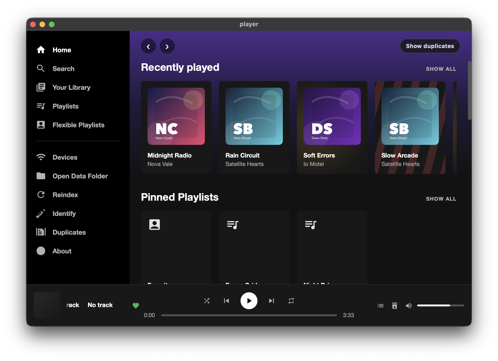
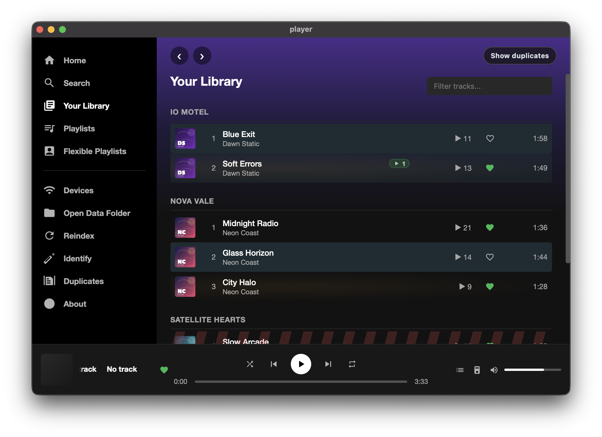
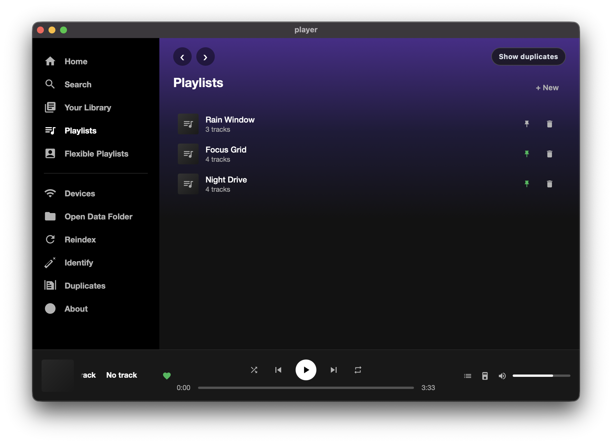
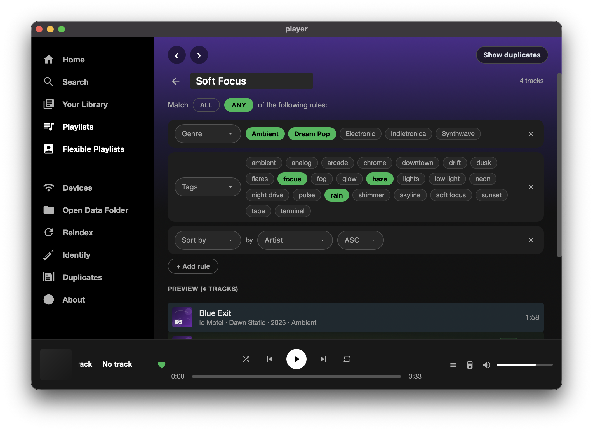
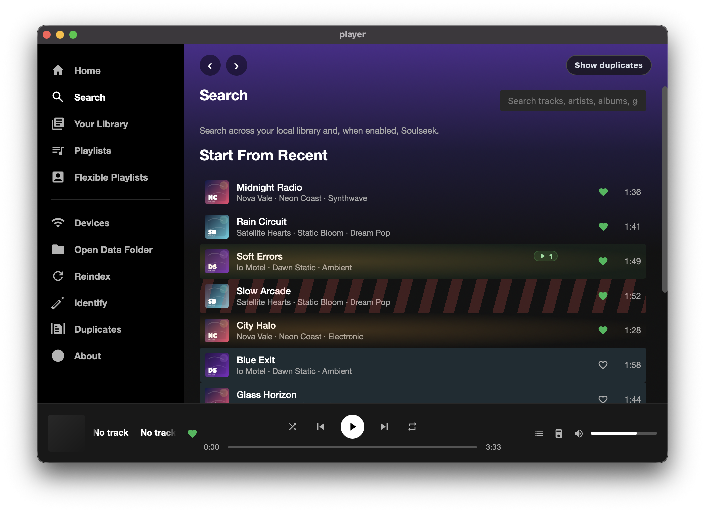
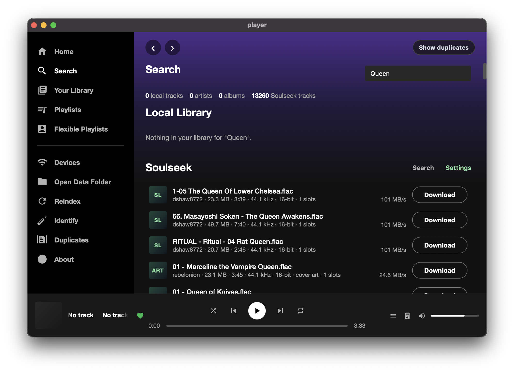
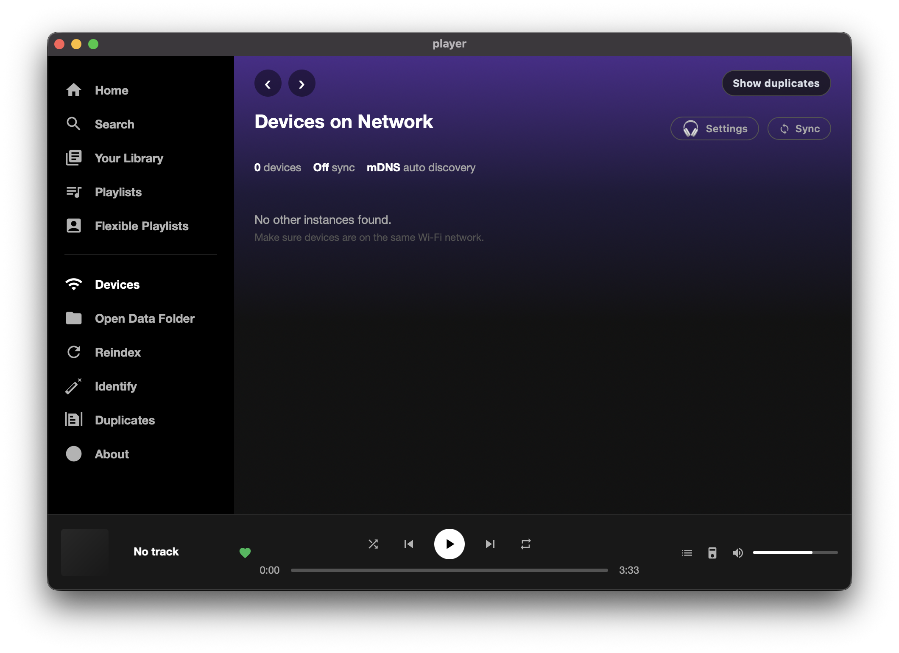

# Player
<p>
  

  <br><br><br>

  <p style="max-width:300px;"><b>Player</b> is a local-first music player built with
  Vue 3, TypeScript, Tauri 2, and Rust.</P>

  <br><br><br>
</p>

<br clear="right">

It is designed for people who keep a real music library on **disk** and want **fast local playback**, **metadata editing**, **playlists**, cross-device **sync on a local network**, and a native-feeling app on both desktop and Android.

This project is not a cloud streaming service! The filesystem is the source of truth, the app database is a fast local index, and sync is optimized for peer-to-peer usage inside your own network.

## Download

<p align="center">
  <a href="https://github.com/verncat/player/releases/latest/download/player-macos-universal.dmg">
    
  </a>
  &nbsp;
  <a href="https://github.com/verncat/player/releases/latest/download/player-windows-x64-setup.exe">
    
  </a>
  &nbsp;
  <a href="https://github.com/verncat/player/releases/latest/download/player-linux-x86_64.AppImage">
    
  </a>
  &nbsp;
  <a href="https://github.com/verncat/player/releases/latest/download/player-android-universal.apk">
    
  </a>
</p>

<p align="center">
  <sub>Direct downloads from the latest GitHub release · <a href="https://github.com/verncat/player/releases/latest">release notes and all packages</a></sub>
</p>

## Overview

Player focuses on a few core jobs:

- Index a local music library and keep it in sync with the filesystem.
- Play audio through a native Rust backend with low-latency controls.
- Browse by artist and album, and store and edit metadata, likes, history, and playlists.
- Build smart playlists from filter rules.
- Discover your other devices on the LAN, sync files and metadata with them, and hand playback over to them.
- Find, preview, and download music from Soulseek.
- Provide a richer now-playing experience with beat-reactive visuals and a WebGL album card.

## Screenshots

These screenshots were captured with the built-in demo mode. Click any image to open the full-size version.

<table>
	<tr>
		<td width="50%" align="center">
			<a href="./readme/first.png">
				
			</a>
			<br />
			<sub>Home with recently played and pinned playlists</sub>
		</td>
		<td width="50%" align="center">
			<a href="./readme/library.png">
				
			</a>
			<br />
			<sub>Library grouped by artist with rich track rows</sub>
		</td>
	</tr>
	<tr>
		<td width="50%" align="center">
			<a href="./readme/playlists.png">
				
			</a>
			<br />
			<sub>Regular playlists</sub>
		</td>
		<td width="50%" align="center">
			<a href="./readme/flexible-playlist-edit.png">
				
			</a>
			<br />
			<sub>Flexible playlist editor with rule-based filters</sub>
		</td>
	</tr>
	<tr>
		<td width="50%" align="center">
			<a href="./readme/search.png">
				
			</a>
			<br />
			<sub>Search starting state with recent listening context</sub>
		</td>
		<td width="50%" align="center">
			<a href="./readme/soulseek-search.png">
				
			</a>
			<br />
			<sub>Soulseek search results inside the app</sub>
		</td>
	</tr>
	<tr>
		<td colspan="2" align="center">
			<a href="./readme/devices.png">
				
			</a>
			<br />
			<sub>Devices and sync view</sub>
		</td>
	</tr>
</table>

## Current Features

### Library

- Recursive local library indexing, kept up to date by a filesystem watcher.
- Metadata from audio tags, with folder-structure and filename fallbacks.
- CUE sheet support: each segment of a single-file album is its own track.
- Artist and album pages, including compilations and guest appearances, with full-size album covers.
- Cover art from embedded tags or sidecar images (`cover.jpg`, `folder.jpg`, ...), stored once per album as small resized copies.
- Track editing and identification through AcoustID fingerprints.
- Likes, play counts, history, and recent tracks.
- Duplicate detection: flags duplicates without deleting anything.
- Drag-and-drop import of files and folders.

### Playback

- Native audio decoding and playback in Rust, for FLAC, MP3, Ogg Vorbis, Opus, WAV, and AAC/ALAC.
- Opus playback through bundled libopus, including seeking, encoder delay, and end padding.
- Seek, pause, resume, stop, and volume control.
- Output device and sample rate selection.
- Queue with shuffle, repeat, and up-next, across lists of any length.
- Beat detection and spectrum data for the visuals.

### Organization

- Regular playlists and smart playlists driven by filter rules, with pinning to the home screen.
- Fast paged library and search, so large libraries stay responsive.
- Reveal a track's file in the file manager, or share it (Android).

### Sync, discovery, and remote playback

- Peer discovery over mDNS.
- Local network sync of files, metadata, playlists, and history between devices.
- Merkle-style reconciliation, so a sync only transfers what changed.
- Play on another device: hand the current track over to a peer and keep controlling it.
- IPv4/IPv6-friendly internal HTTP server. There's no authentication, so use it on networks you trust.

### Soulseek integration

- Search from inside the app, with cover previews.
- Streaming previews that start playing while the file downloads.
- Downloads straight into the library, organized as `Artist/Album/file`.
- Track replacement: swap a track's file for a better copy and keep its metadata, likes, and history.

### UI and platform

- Responsive desktop/mobile layout.
- Android media notification and lock-screen controls.
- Now-playing view with a Three.js/WebGL album card.
- Dark and light themes (or following the system) with a choice of accent color and header gradient.
- Settings page for library tools, audio output, device identity and sync, Soulseek, and appearance (theme, accent color, gradient, tint, reduced motion).
- Optional Discord Rich Presence on desktop, off by default.
- About section with version info, update checks, an embedded changelog, contributors, and third-party licenses.
- Demo mode with a seeded library (`--demo`), used for the screenshots above.

## Desktop updates

Windows, macOS, and Linux releases use the signed Tauri Updater flow. Release builds publish
platform updater bundles, their `.sig` files, and a generated `latest.json` manifest to GitHub
Releases. Android keeps the release-page/APK fallback because the official Tauri updater does
not install mobile packages.

The updater public key is committed in `src-tauri/tauri.conf.json`. Keep the matching private
key outside the repository and back it up: losing it prevents shipping updates to existing
installations.

Before running the release workflow, configure this GitHub Actions secret:

```bash
gh secret set TAURI_SIGNING_PRIVATE_KEY < /path/to/player-updater.key
```

The current key has no password. If it is replaced with an encrypted key, also configure
`TAURI_SIGNING_PRIVATE_KEY_PASSWORD`. For a signed local bundle, run:

```bash
TAURI_SIGNING_PRIVATE_KEY=/path/to/player-updater.key \
TAURI_SIGNING_PRIVATE_KEY_PASSWORD='' \
pnpm tauri build
```

## Tech Stack

- Frontend: Vue 3, TypeScript, Vite.
- Desktop/mobile shell: Tauri 2.
- Backend: Rust.
- Audio decode: Symphonia with bundled libopus for Opus.
- Audio output: CPAL.
- Metadata extraction: lofty.
- Cover resizing: image.
- Local database: SQLite via rusqlite.
- File watching: notify.
- LAN discovery: mdns-sd.
- Sync transport: tiny_http + reqwest.
- Soulseek: soulseek-rs (vendored).
- Audio identification: rusty-chromaprint + AcoustID.
- 3D visuals: Three.js.
- Icons: Lucide.
- Discord Rich Presence: discord-rich-presence.
- Logging and profiling: tracing, optional Tracy.

## Architecture at a glance

The project is split across a few runtime boundaries:

- Vue owns screen state, queue behavior, interaction flow, and visual presentation.
- Rust owns playback, indexing, persistence, sync, discovery, and native integration.
- Android-specific code owns OS-facing media session and notification behavior.

Main source files:

- `src/App.vue`: the application shell: navigation, queue, and playback coordination.
- `src/components/`: extracted UI, such as the player bar, track rows, artist and album pages, the settings page, and the WebGL album card.
- `src-tauri/src/lib.rs`: Tauri bootstrap and command registration.
- `src-tauri/src/library.rs`: library index, metadata, playlists, history, duplicates.
- `src-tauri/src/covers.rs`: cover store, served to the UI over a `cover://` URL scheme.
- `src-tauri/src/playback.rs`: playback engine, beat detection, spectrum.
- `src-tauri/src/audio_codecs.rs`: the codecs playback decodes with, including Opus through libopus.
- `src-tauri/src/discovery.rs`: peer discovery.
- `src-tauri/src/sync.rs`: sync protocol, peer HTTP server, remote playback.
- `src-tauri/src/plugins/soulseek.rs`: Soulseek integration.

For a deeper architecture write-up, see [DESIGN.md](./DESIGN.md).

## Development

### Prerequisites

- Node.js 20+.
- pnpm.
- Rust toolchain.
- CMake and a C/C++ toolchain, to compile the bundled libopus.
- Tauri system dependencies for your platform. On Linux: webkit2gtk-4.1, ALSA (libasound), libappindicator3, and librsvg2.
- Android SDK/NDK if you want Android builds.

### Install

Plugin sources come from [player-plugins](https://github.com/verncat/player-plugins),
pinned as the `plugins/` git submodule. Initialize it before building or running tests:

```bash
git submodule update --init -- plugins
pnpm install
```

### Run in development

```bash
pnpm tauri dev
```

### Run in demo mode

Demo mode uses a separate, seeded library and doesn't touch your own:

```bash
pnpm tauri dev -- -- --demo
```

### Check and test

```bash
pnpm build                 # refresh licenses and contributors, frontend typecheck and bundle
pnpm test:licenses         # tests for the build scripts
pnpm test:contributors
cd src-tauri && cargo test # Rust tests
```

### Profile library indexing with Tracy

Run the optimized, instrumented desktop build, then connect the Tracy Profiler
UI to `127.0.0.1`:

```bash
pnpm tauri:tracy
```

The `tracy` Cargo feature is disabled by default. Its client accepts local
connections only and starts collecting on demand. Trigger **Reindex** in the app
to capture directory walking, database lock waits, metadata and cover reads,
file hashing, SQLite writes, CUE indexing, stale cleanup, and watcher batches.

### Build desktop app

Native builds compile libopus from source (see Prerequisites), so no separate
Opus library is required on the user's device.

```bash
pnpm tauri build
```

Frontend builds refresh the About contributor list from GitHub and bundle their
avatars, so the credits also work offline. If GitHub is unavailable, the build
uses the saved snapshot in `src/generated/contributors.json` and
`public/generated/contributors/`. Keep these generated files in version control.

Run `pnpm contributors:sync` to refresh the snapshot separately. The script uses
`GITHUB_REPOSITORY` or the GitHub origin remote, and optionally accepts
`GITHUB_TOKEN` or `GH_TOKEN` for authenticated API requests. Release builds pass
the GitHub Actions token automatically. Tokens are never included in the credits
or sent when downloading avatars.

### Android

```bash
pnpm android:build
pnpm android:build-deploy
```

## Repository notes

- `soulseek-rs-repo/` contains an upstream/workbench copy of the Soulseek project.
- `src-tauri/vendor/soulseek-rs-lib/` contains the vendored library currently used by the app.
- `src-tauri/vendor/symphonia-format-ogg/` is a patched copy of Symphonia's Ogg demuxer that fixes Opus gapless trimming; `PATCHES.md` there lists the changes.
- `src-tauri/gen/android/` contains generated Android project files produced for the Tauri mobile target.

## Status

This project is actively evolving. The architecture is intentionally pragmatic: some surfaces are already well-isolated, while others are still consolidated to keep product iteration fast.

If you want the full descriptive architecture document, read [DESIGN.md](./DESIGN.md).

### Plugin development

See [the plugin guide](docs/plugin/readme.md) for package installation, the SDK,
UI contributions, native capabilities and development scopes.
